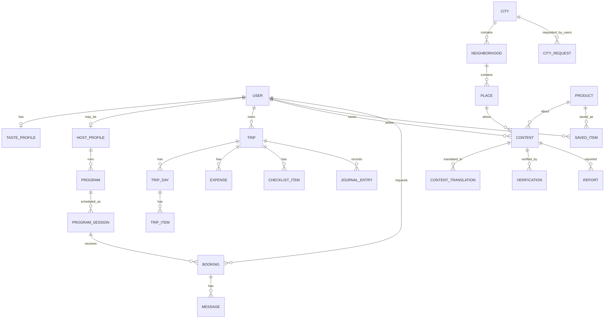

# 데이터 모델과 신뢰 배지 규칙 (7단계 초안)

> 범위: P0 필수 + P1·P2 확장을 고려한 구조. 필드는 기획 수준의 초안이며, 구현 전 개발자 검토가 필요하다.

---

## 1. 설계 원칙

1. **콘텐츠는 하나의 엔진**: 장소 추천, 생활 팁, 식품 리뷰, 질문은 `Content` 한 테이블의 유형(type)으로 관리하고, 신뢰 필드를 공통으로 붙인다.
2. **원문 + 번역 분리**: 사용자는 원어로 작성하고, 번역본은 별도 저장한다. 신뢰 배지 문구는 번역하지 않고 코드값으로 저장해 화면에서 6개 언어로 렌더링한다.
3. **Trip 중심 구조**: 저장함, 일정, 예산, 준비물, 기록은 모두 `Trip`(또는 개인 저장함)에 귀속된다.
4. **신뢰는 사실(fact)로 저장하고 점수는 파생**: "방문일", "인증 수단", "협찬 여부"를 원시 값으로 저장하고, 정렬용 점수는 계산해서 쓴다.
5. **증빙 최소 보관**: 인증에 쓴 사진·영수증은 검증 결과만 남기고 원본은 짧은 기간 후 삭제한다.

---

## 2. 엔터티 관계도



---

## 3. 엔터티 정의

### 3-1. 사용자·프로필
| 엔터티 | 주요 필드 | 비고 |
|---|---|---|
| **User** | id, email/소셜 id, display_name, ui_language, content_languages[], home_country, role(traveler/host/admin), created_at, status | 한 사용자가 여행자이면서 호스트일 수 있음 |
| **TasteProfile** | user_id, place_tags[](조용한 골목·카페·서점…), travel_style, pain_points[], food_taste{sweet,salty,spicy}(0~5) | 온보딩 결과. 장소·동네·식품 추천 정렬에 공통 사용 |
| **HostProfile** | user_id, home_city_id, years_in_city, bio_original, languages[], interests[], identity_status(none/pending/verified), verified_at, rating_avg, review_count | `identity_status`가 현지인 배지와 프로그램 개설의 전제 |

### 3-2. 지역·장소
| 엔터티 | 주요 필드 | 비고 |
|---|---|---|
| **City** | id, name_i18n{ko,en,ja,zh,es,de}, country, timezone, currency, status(open/coming_soon), open_threshold | 도시 오픈 여부 관리 |
| **CityRequest** | id, user_id, city_name, country, created_at | 요청 수가 기준 이상이면 오픈 검토 |
| **Neighborhood** | id, city_id, name_i18n, tags[], summary_original, geo(polygon/center) | 탐색의 기본 단위 |
| **Place** | id, neighborhood_id, category(맛집·카페·공원·마켓·독립서점·기타), name_original, name_i18n, geo, address, external_ref, **life_tip{open_days, payment_methods[], best_time, recommended_menu[], photo_policy, solo_friendly}**, status | 생활 팁은 장소의 구조화 필드. 사용자 작성 콘텐츠가 쌓이면 "최근 확인값"으로 갱신 |

### 3-3. 콘텐츠 엔진 (핵심)
| 엔터티 | 주요 필드 | 비고 |
|---|---|---|
| **Content** | id, type(place_rec / life_tip / food_review / question / answer), author_id, target_type(place/product/content), target_id, original_language, body_original, structured{ }, **visit_date, written_at, updated_at**, **author_role(local/traveler)**, **sponsored(none/gifted/paid/affiliate)**, **verification_level(0~3)**, status(published/hidden/under_review), freshness_status | 신뢰 관련 굵은 필드는 모든 유형 공통 |
| **ContentTranslation** | content_id, language, body, engine, translated_at, reviewed(boolean) | 원문 보기 전환용. 원문 수정 시 재번역 |
| **Verification** | id, content_id, method(photo_meta/location_checkin/receipt/booking), result(pass/fail/pending), checked_at, expires_at, evidence_ref(null 가능) | 원본 증빙은 보관기간 후 삭제, 결과만 유지 |
| **Report** | id, content_id, reporter_id, reason(ad/fake/outdated/abuse/other), status, handled_by, handled_at | 신고 누적 규칙은 §5 |

`structured` 예시
- 식품 리뷰: `{taste, texture, rebuy_intent, sweet, salty, spicy, price_paid, purchase_place}`
- 장소 추천: `{best_time, solo_friendly, price_level}`

### 3-4. 내 여행
| 엔터티 | 주요 필드 | 비고 |
|---|---|---|
| **Trip** | id, user_id, city_id, start_date, end_date, base_currency, status(planning/ongoing/done), visibility(private 기본) | |
| **TripDay / TripItem** | day_id, trip_id, date / item_id, day_id, place_id 또는 program_session_id, order, start_time, duration, note, visited(boolean), visited_at | 방문 체크 시 기록·인증의 근거가 됨 |
| **SavedItem** | user_id, target_type(place/product/program), target_id, trip_id(null=전체 저장함), saved_at | 저장함은 일정 후보함 |
| **Expense** | id, trip_id, amount, currency, amount_base, fx_rate, fx_date, category, place_id(null), memo, spent_at | 환율과 기준일을 함께 저장 |
| **ChecklistItem** | id, trip_id, text, group(출발전/짐/현지), due_date, done | 도시 템플릿에서 복사 |
| **JournalEntry** | id, trip_id, place_id, photos[], memo, created_at, visibility | 일정이 기록으로 전환되고 "추천 작성" 전환의 입구 |

### 3-5. 로컬 프로그램·동행 (P2)
| 엔터티 | 주요 필드 | 비고 |
|---|---|---|
| **Program** | id, host_id, type(walk/food_market/companion), title_original, city_id, neighborhood_id, languages[], capacity, price_type(free_cost_share/paid), price_amount, currency, meeting_point(공공장소 여부), status | 법무 확인 전에는 price_type을 free_cost_share로 제한 |
| **ProgramSession** | id, program_id, start_at, end_at, capacity_left | |
| **Booking** | id, session_id, user_id, status(requested/accepted/declined/cancelled/completed/no_show), note, created_at | 확정 시 TripItem 자동 생성 |
| **Message** | id, booking_id, sender_id, body_original, translated, sent_at | 연락처는 확정 전 비공개 |

### 3-6. 식품 (P2)
| 엔터티 | 주요 필드 | 비고 |
|---|---|---|
| **Product** | id, country, name_i18n, brand, category, price_range, ingredients, allergens[], how_to_eat, barcode(null), image | 리뷰·질문은 `Content`로 연결 |
| **ProductComparison** | user_id, product_ids[], criteria | 필요 시 저장, 기본은 화면 상태 |

---

## 4. 신뢰 배지 규칙

### 4-1. 배지 종류와 부여 조건

| 배지 | 의미 | 부여 조건 | 표시 |
|---|---|---|---|
| **방문일** | 언제 다녀왔는지 | 작성 시 필수 입력. 미래 날짜 불가 | 모든 콘텐츠 |
| **작성일/수정일** | 정보의 시점 | 시스템 자동 | 모든 콘텐츠 |
| **직접 방문 선언 (L0)** | 작성자가 직접 다녀왔다고 선언 | 방문일 입력 + 선언 체크 (P0 필수) | "직접 방문했다고 작성자가 밝힘" |
| **현장 체크인 (L1)** | 방문 시점에 장소 근처에 있었음 | 웹 위치 확인 1회 → 장소 반경 내 여부만 저장(좌표 미저장). 방문일 ±1일 내 작성 시 | 배지 ✓ |
| **사진 첨부 (보조)** | 사진 제공 | 작성자가 직접 올린 사진. 메타데이터 일치 여부는 **점수 보조 신호**로만 사용, 배지 아님 | 사진 아이콘 |
| **구매·예약 확인 (L2)** | 구매·예약 사실 확인(강) | 영수증 또는 앱 내 예약·프로그램 완료 기록 (P2) | 배지 ✓✓ |
| **현지인** | 해당 도시 거주자 | 호스트 신원 확인 완료 + 거주 도시 설정 + 거주 기간 입력(운영팀 샘플 검수) | 작성자 라벨 |
| **여행자** | 방문자 | 기본값 | 작성자 라벨 |
| **광고·협찬** | 이해관계 표시 | 작성자 선택. 선택하지 않았으나 신고·검수로 확인되면 운영자가 부여 | 노란 라벨, 정렬 가중치 하향 |
| **정보 오래됨** | 최근 확인 필요 | 방문일 또는 마지막 갱신일이 12개월 초과 (식당·운영시간은 6개월) | 회색 라벨 |
| **최근 확인** | 최신 정보 | 최근 3개월 내 다른 사용자가 "여전히 맞아요" 투표 | 녹색 라벨 |

### 4-2. 실경험 인증 방식 (결정 필요)
| 방식 | 장점 | 단점 |
|---|---|---|
| 사진 메타데이터 | 사용자 부담 적음 | 메타가 제거된 사진이 많음, 위조 가능 |
| 위치 체크인 | 정확하고 간단 | 위치 권한·개인정보 부담, 방문 후 작성엔 부적합 |
| 영수증 | 신뢰도 가장 높음 | 업로드 번거로움, 개인정보 포함 가능 |
| 앱 내 일정 방문 체크 | 자연스러운 수집 | 자기 체크라 자체 증빙력은 약함 |

**확정안 (P0)**: 처음 제안(체크인 + 사진 메타 자동 인증)에서 **수정**했다.
- **L0 방문 선언**을 기본으로 하고, **현장 체크인(L1)은 선택**으로 둔다. 인증이 없어도 작성은 가능하다.
- **사진 메타데이터는 인증 배지에서 제외**하고 점수 보조 신호로만 쓴다. (웹에서 업로드 시 위치·촬영 정보가 제거되는 경우가 많아 배지 근거로 불안정할 수 있음. 실제 기기 테스트로 확인 필요)
- 체크인은 **좌표를 저장하지 않고 "반경 내 여부"만 저장**한다. 위치 권한은 체크인 버튼을 누를 때만 1회 요청한다.
- 영수증(L2)은 식품 리뷰와 프로그램 후기(P2)에 적용한다. 증빙 원본은 검증 후 **30일 이내 삭제**(기간은 개인정보 검토 후 확정).
- 배지 문구는 "인증됨"이 아니라 **무엇을 확인했는지**를 쓴다. (예: "방문일 근처 현장 체크인")

**수정 이유**
1. 웹서비스라 앱처럼 백그라운드 위치 수집이 어렵고, 위치 확인은 사용자가 그 자리에서 직접 눌러야 한다. 방문 후 작성하는 콘텐츠 대부분은 L1을 못 받는다.
2. 사진 메타데이터는 기기·브라우저에 따라 제거되거나 사용자가 끌 수 있고 위조도 가능해, 이를 "✓"로 보여 주면 과신을 부른다.
3. 위치 정보는 개인정보이고 독일·스페인 이용자는 EU 규정 대상이라, 수집량을 줄이는 쪽이 안전하다.
4. P0에서 신뢰를 만드는 힘은 인증 자체보다 **방문일 표시, 현지인 라벨, 협찬 표기, 신고·검수, 에디터 시드 콘텐츠**에서 나온다.

### 4-3. 정렬용 신뢰 점수 (내부용, 화면에 숫자로 노출하지 않음)

```
trust = 0.35·실경험 레벨(0~3 정규화)
      + 0.25·최신성(방문일 기준 감쇠)
      + 0.20·작성자 신뢰(현지인 여부, 과거 콘텐츠 신고 이력, 계정 연령)
      + 0.20·커뮤니티 반응(도움돼요·"여전히 맞아요")
× 협찬 페널티(협찬 0.7, 유료 0.5)
```
가중치는 초기 가정이며 운영 데이터로 조정한다.

### 4-4. 광고성·어뷰징 관리
| 상황 | 처리 |
|---|---|
| 신고 3건(서로 다른 사용자) | 자동으로 `under_review`, 검수 큐 진입. 검수 전까지 정렬 하향 |
| 협찬 미표기 확인 | 라벨 부여 + 경고. 반복 시 작성 제한 |
| 동일 작성자가 같은 장소에 중복 작성 | 최신 1건만 노출, 나머지 병합 |
| 신규 계정(7일 미만) 다량 작성 | 일일 작성 한도, 실경험 L2 미만은 정렬 가중치 낮춤 |
| 가게 관계자의 자기 가게 작성 | 작성 시 "관계자 아님" 선언 문구. 위반 시 콘텐츠 삭제, 계정 제재 |
| 번역 중 의미 변형 신고 | 번역본 숨김, 원문 우선 노출, 재번역 |
| 개인정보·혐오·불법 | 즉시 숨김 후 검수 |

### 4-5. 호스트 신뢰
- 호스트 프로필 노출 조건: **신원 확인 완료**
- 프로그램 후기는 **완료된 Booking에서만** 작성 가능 (자동 L3)
- 노쇼·취소·신고 이력이 임계치를 넘으면 신규 프로그램 개설 제한

---

## 5. 다국어·번역 규칙
- 배지·라벨·상태값은 **코드값 저장 + 6개 언어 문구 사전**으로 렌더링한다.
- 콘텐츠 본문은 원문 저장, 번역은 요청 시 또는 게시 시 생성해 캐시한다.
- 번역본에는 항상 "번역됨 · 원문 보기"를 표시한다.
- 지명·가게명은 번역하지 않고 `name_original`을 함께 노출한다.

---

## 6. 단계별 구현 범위

| 단계 | 포함 엔터티·규칙 |
|---|---|
| **P0** | User, TasteProfile, City, CityRequest, Neighborhood, Place(+life_tip), Content(place_rec/life_tip), ContentTranslation, SavedItem, Trip, TripDay, TripItem, Report / 방문일·작성일·여행자/현지인 라벨, 방문 선언(L0), 현장 체크인(L1, 선택), 협찬 표기, 신고 → 검수 |
| **P1** | Expense, ChecklistItem, JournalEntry, 즉흥 추천 입력 로그 / 정보 오래됨·최근 확인, 사진 메타 보조 신호, 신뢰 점수 정렬 |
| **P2** | HostProfile, Program, ProgramSession, Booking, Message, Product, 식품 Content / 호스트 신원 확인, 구매·예약 확인(L2), 호스트 신뢰 규칙 |
| **P3** | ProductComparison 저장, 사진 검색용 제품 이미지/바코드, 동행 매칭 안전 규칙 |

---

## 7. 결정이 필요한 항목

1. **실경험 인증 방식**: 위 제안(체크인 + 사진 메타)으로 갈지, 영수증을 P0에 넣을지
2. **현지인 인증 강도**: 신분증 기반 확인(비용·개인정보 부담) vs 자기신고 + 샘플 검수
3. **증빙 보관 기간**: 30일 제안, 국가별 개인정보 규정(GDPR 등) 검토 필요. 독일·스페인 이용자 대상이면 **EU 개인정보 규정 검토가 출시 전 필수**
4. **번역 엔진**: 기계번역 + 사용자 신고 기반 교정으로 시작할지
5. **장소 데이터 출처**: 지도·장소 DB를 외부 서비스에서 가져올지, 자체 구축할지 (라이선스·비용 영향)
